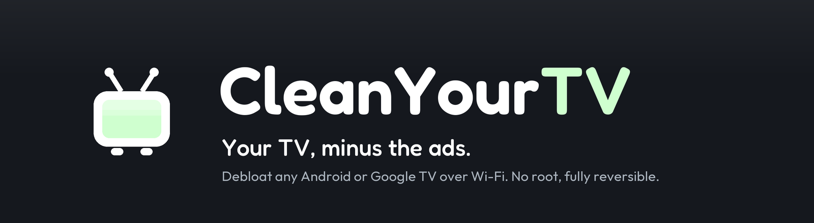
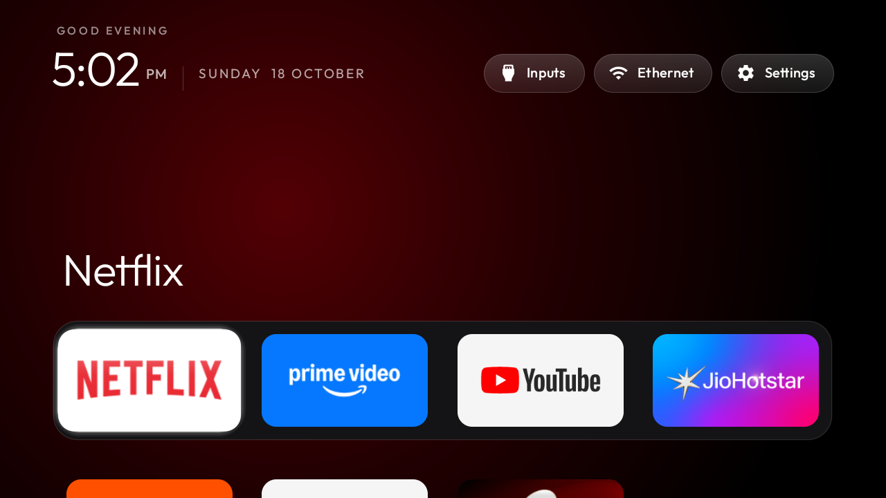
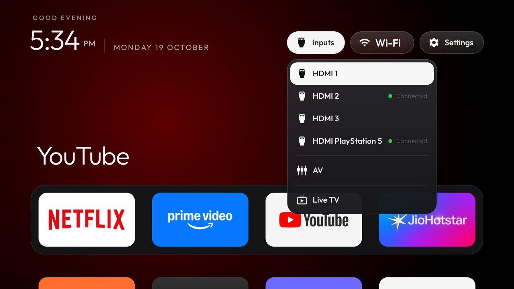
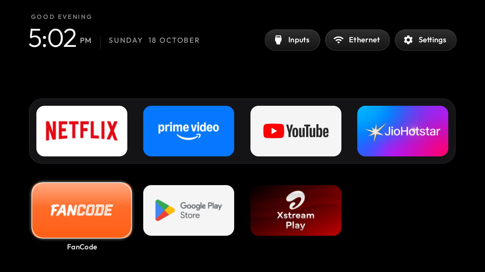
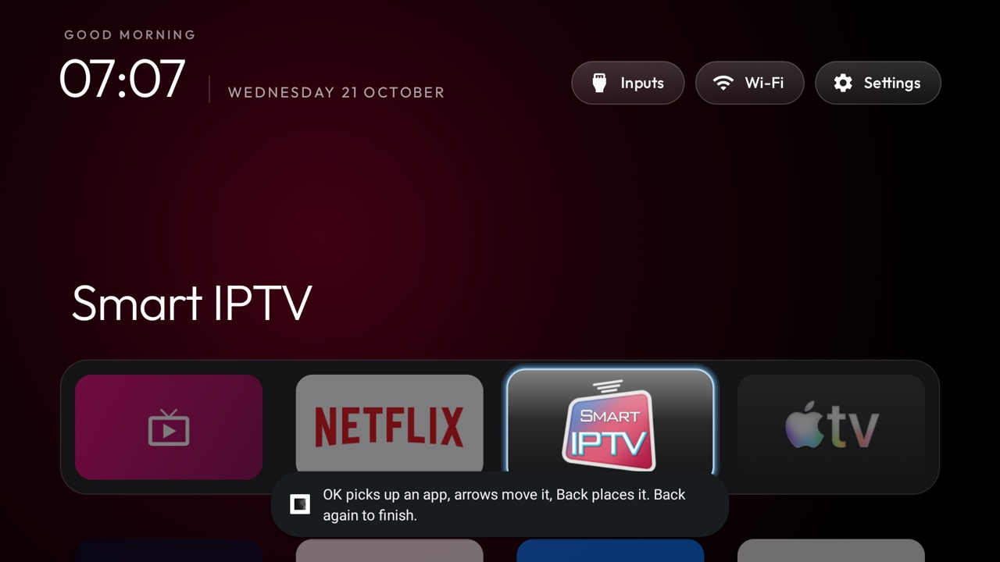

# ClearTV 📺

<p align="center">
  
</p>

<p align="center">
  <strong>An ultra-fast, privacy-first, zero-bloat launcher & management suite for Android TV and Google TV.</strong>
</p>

<p align="center">
  
  
  
  
</p>

---

## 📖 Overview

Modern Smart TVs ship bogged down by unskippable home screen ads, heavy OEM telemetry, sponsored content rows, and laggy launchers. **ClearTV** strips away the bloat and delivers an ultra-responsive, Apple TV-inspired minimalist home screen that gets out of your way.

* **No root required.**
* **No cables needed** (works entirely over local Wi-Fi via ADB).
* **100% non-destructive and reversible** (uses `pm disable-user`, leaving core system packages intact with a one-command restore).

---

## ✨ Key Features

| Feature | Description |
|---|---|
| 🚫 **Zero Ads & Tracking** | Disables OEM tracking daemons, analytics, and sponsored ad carousels without breaking system functions. |
| ⚡ **Sub-500KB Native Launcher** | Built in lightweight native Java with AndroidX DynamicAnimation. Zero webviews, zero telemetry, buttery 60 FPS even on 1 GB RAM chipsets. |
| 🎨 **Adaptive Theming & 6-Column Grid** | High-density 6-column layout with 32-bit true color and time-of-day shifting dynamic wallpapers (Morning, Sunset, Night). |
| 🎮 **Remote Control Remapping** | Direct hardware keycode mapping for remote buttons (Netflix, YouTube, Prime Video, Live TV tuner, and quick settings panel). |
| 🧩 **Modular Dock Cards** | Support for extensible add-on cards in the dock row (such as live weather forecast, system stats, and AirPlay discovery). |
| 🔒 **Safety & Home Guard** | Built-in Home guard prevents black screens and ensures safe fallbacks before any stock launcher service is modified. |

---

## 🖼️ Interface Preview

| Focused Dock & Ambient Glow | Inputs & Tuner Switcher |
|:---:|:---:|
|  |  |
| *Adaptive glow matching app artwork* | *Direct HDMI, AV, and Live TV source switching* |

| Smooth Spring Grid | Floating Tile Manager |
|:---:|:---:|
|  |  |
| *Clean app drawer with smooth focus spring* | *Hold OK on any tile to move or organize* |

---

## 🚀 Quick Start

### 1. Enable Developer Mode on Your TV
1. On your Android TV / Google TV, go to **Settings → Device Preferences → About**.
2. Scroll to **Build** and press the remote's **OK / Center** button 7 times until it says *"You are now a developer!"*.
3. Go back to **Settings → Device Preferences → Developer options**.
4. Turn on **USB Debugging** (and **Network Debugging / Wireless Debugging** if present).

### 2. Connect via ADB
From your computer on the same Wi-Fi network:
```bash
# Connect to your TV's local IP address
adb connect <tv-ip>:5555
```
*Look at your TV screen and select **"Always allow from this computer"** when prompted.*

### 3. Backup & Debloat
ClearTV disables manufacturer junk safely:
```bash
# Backup existing packages
python3 tools/tv.py --backup

# Disable bloatware packages safely (customizable per brand)
./tools/disable.sh examples/tcl-g03-4k-gb/debloat.txt
```

### 4. Build & Install the ClearTV Launcher
```bash
cd launcher
./build-and-install.sh
```

---

## 🎨 Themes & Customization

ClearTV includes built-in themes that can be applied instantly without rebuilding the launcher:

```bash
# Push any theme directly to your TV
./tools/theme.sh themes/retro
```

Available themes in `themes/`:
* `retro`: Clean black dock with time-of-day shifting dynamic wallpapers.
* `glass`: Translucent frosted glass tiles and ambient backdrops.
* `cinematic`: Dark, immersive movie-theater styling.
* `red-rain`: High-contrast cyberpunk matrix aesthetic.

---

## 🔄 Instant Restore

If you ever want to revert back to your stock TV interface or prepare the TV for resale, everything can be undone with a single command:

```bash
./tools/restore.sh
```
All disabled OEM applications and original settings are restored immediately.

---

## 📁 Repository Structure

```text
├── launcher/          # Reference lightweight Android TV launcher (Java, AndroidX)
├── themes/            # Custom themes, color palettes, and wallpaper sets
├── addons/            # Modular card add-ons (Weather, AirPlay, etc.)
├── tools/             # Python & shell ADB automation scripts
├── examples/          # Tested debloat profiles organized by TV brand & board
├── docs/              # In-depth hardware guides and troubleshooting
└── PROMPT.md          # Interactive prompt for AI agent-assisted TV setup
```

---

## 📄 License & Credits

* Distributed under the **MIT License**. See `LICENSE` for details.
* Inspired by the open-source Android TV community and CleanYourTV foundations.
